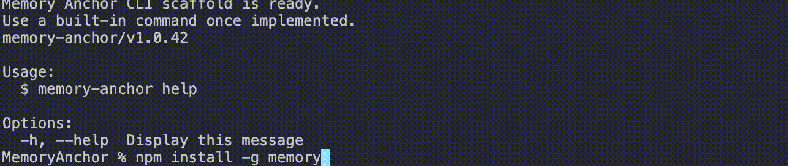

# Memory Anchor

Memory Anchor is a local, file-based memory layer for coding agents. It turns a repository into a compact set of architecture charts, keeps durable project rules and decisions beside the code, and refreshes that memory from Git changes as agents work.


## Quick start

```bash
npm install -g memory-anchor

cd /path/to/your/project
anchor init
anchor status
```

`anchor init` builds the initial partitioned chart and configures every supported agent. Use an `init-<agent>` command when only one integration is needed.

## What Memory Anchor stores

Memory Anchor keeps its generated state under `.memoryanchor/`:

| Path | Purpose |
| --- | --- |
| `.memoryanchor/chart/**/chart.md` | Directory-scoped architecture charts containing a dependency skeleton, extracted symbols, and in-chart reverse symbol dependencies. |
| `.memoryanchor/refresh-checkpoint.json` | File metadata fingerprints recorded after successful refreshes; skips unchanged dirty files. |
| `.memoryanchor/dirTree.json` | Internal directory topology, aggregate character counts, and split state used by incremental updates. |
| `.memoryanchor/guardrails.md` | Durable repository-specific guardrails; managed defaults are removed during migration. |
| `.memoryanchor/project-state.md` | Current module status, known issues, and dependencies. |
| `.memoryanchor/decisions.md` | Architectural decisions and rationale. |
| `.memoryanchor/prompt-hooks.json` | Optional UserPrompt hook selection; absent or empty means disabled. |
| `.memoryanchor/debug.json` | Opt-in persistent diagnostic logging setting, managed by `anchor debug`. |
| `.memoryanchor/debug.log` | Append-only CLI and lifecycle diagnostics while debug mode is enabled. |
| `AGENTS.md` | Workflow instructions telling agents how to query architecture through MCP and maintain project memory. |

Charts are generated output and should not be edited manually. Guardrails, project state, and decisions are intentionally readable project memory.

## Why partition the chart?

A single repository chart eventually becomes expensive to inject and slow to rebuild. Memory Anchor instead measures each directory subtree and creates chart boundaries only where they are needed.

During a full build it:

1. Scans directories deepest-first.
2. Generates architecture content with tree-sitter and records aggregate character counts.
3. Splits directory subtrees above `18000` characters.
4. Writes one chart for every first non-split directory on each branch.
5. Persists chart ownership in `dirTree.json` for MCP queries and incremental updates.

The output mirrors the source tree. For example:

```text
.memoryanchor/
├── dirTree.json
├── guardrails.md
├── project-state.md
├── decisions.md
└── chart/
    ├── src/
    │   ├── chartBuild/chart.md
    │   ├── commands/chart.md
    │   └── hooks/chart.md
    └── tests/chart.md
```

At session start, Memory Anchor injects concise MCP guidance, repository guardrails, project state, and decisions in full. Query `get_chart({path})` or `get_file({path})` for the task directly; no routing index or root chart is injected. Re-running initialization removes the legacy index and managed default rules while preserving custom rules.

## Incremental updates

Stop and session-end hooks read the Git working-tree changes and pass the changed paths to the partitioned incremental updater. The legacy `updateChartIncrementally` API remains available and points to this same implementation.

For each changed file, the updater:

1. Finds the first non-split directory partition on the file path.
2. Updates only that partition chart.
3. Propagates the exact character delta through its directory ancestors.
4. Applies hysteresis to avoid unstable boundary oscillation.
5. Rebuilds only the affected boundary when topology changes.

The thresholds are:

- Split when a non-split directory grows above `18000` characters.
- Merge when a split directory shrinks below `14000` characters.
- Keep the current state inside the neutral `14000–18000` band.

Growth stops structural propagation after the first split; higher ancestors only need updated metadata. Shrinkage continues checking merge eligibility through the root because a merge can cascade upward. When several ancestors merge, only the highest merged boundary is rebuilt because that rebuild already includes every lower subtree.

Each incremental batch also keeps a temporary Set of rebuilt directories. If a later changed file is inside a directory already rebuilt from disk, its redundant parse/update work is skipped. Matching walks exact path ancestors, so similarly named siblings such as `src/a` and `src/abc` cannot collide.

If the partition registry or required output topology is missing, the compatibility entry safely falls back to a full partitioned build.

## MCP chart queries

`anchor init` now registers the Memory Anchor MCP server alongside the existing
agent integrations. The platform-specific `anchor init-claude`, `init-codex`,
`init-codebuddy`, `init-qodercn`, `init-copilot`, `init-opencode`, and `init-hermes`
commands register it for that platform. `init-public` remains common-files-only.

| Client | Registration location |
| --- | --- |
| Claude Code, CodeBuddy, Qoder CLI, Copilot CLI | Project `.mcp.json` → `mcpServers.memory-anchor` |
| Codex | Project `.codex/config.toml` → `[mcp_servers.memory-anchor]` |
| OpenCode | Project `opencode.json` → `mcp.memory-anchor` |
| Hermes | `$HERMES_HOME/config.yaml` (default `~/.hermes/config.yaml`) → `mcp_servers.memory-anchor` |

Registration pins the current Node executable and installed `dist/cli.js`, so it
also works from a source checkout after `npm run build`. Project registrations
pass an absolute `--workspace`. Hermes has global configuration, so its entry
uses the server's startup working directory instead; launch Hermes from the
initialized project root. Initializing another project does not retarget that
global entry. Outside an initialized workspace, tool discovery works but queries
return a workspace error.

Existing same-name entries are left unchanged, including custom commands,
environment variables, and disabled settings. Other servers are preserved;
Codex TOML is validated and appended without rewriting existing text, and Hermes
YAML editing preserves comments. If the installation moves and an existing entry
points to an old executable, update that entry explicitly. `.mcp.json` is added
to the generated gitignore because registrations include machine-local paths.

Restart or reload your client after initialization. Client trust, project-server
approval and tool policies still apply; initialization does not auto-approve
servers or override those policies. See the official configuration references
for [Codex](https://learn.chatgpt.com/docs/extend/mcp?surface=cli),
[Claude Code](https://code.claude.com/docs/en/mcp),
[Copilot CLI](https://docs.github.com/en/copilot/how-tos/copilot-cli/customize-copilot/add-mcp-servers),
[Qoder](https://docs.qoder.com/cli/mcp-reference),
[OpenCode](https://opencode.ai/docs/mcp-servers/), and
[Hermes](https://hermes-agent.nousresearch.com/docs/user-guide/features/mcp).

Tool-use guidance is injected through the existing shared session-context path
(OpenCode uses its system-transform plugin), and is also advertised in MCP's
initialize response `instructions`. It explains which tool to choose, scoped
charts, bounded source reads, freshness uncertainty and direct-file fallback when
MCP is unavailable. Repository guardrails, project state, decisions and this guidance occupy the
normal context. Optional UserPrompt reminders stay opt-in.

For manual setup, run `anchor mcp --workspace /absolute/path/to/project` to expose an initialized
workspace over MCP stdio. Without `--workspace`, the current working directory is
used. The client starts and stops the process; stdout is reserved for MCP messages.
The server does not open a network port or rebuild charts.

Example configuration for clients using the `mcpServers` JSON convention:

```json
{
  "mcpServers": {
    "memory-anchor": {
      "command": "anchor",
      "args": ["mcp", "--workspace", "/absolute/path/to/project"]
    }
  }
}
```

When running from a source checkout, build with `npm run build`, use `node` as the
command and prepend `/absolute/path/to/MemoryAnchor/dist/cli.js` to `args`.
This manual configuration is optional when using an initializer listed above.

Two read-only tools are available:

| Tool | Arguments | Result |
| --- | --- | --- |
| `get_chart` | `path` (default `.`) | Covering chart, actual scope/mode, child chart routes and artifact timestamps. |
| `get_file` | `path`, optional `include_source`, `start_line`, `end_line` | Exact file architecture block, chart location, timestamps and optional current source. |

Paths are relative to the configured workspace; absolute paths inside it are also
accepted. Directory queries resolve persisted partition ownership: a nested
directory may return its ancestor's recursive chart. A split directory with no
direct files returns `chart: null` and routes to its nearest child charts.
File queries preserve generated symbols, multiline signatures, line ranges,
dependencies and callers, without returning unrelated file entries.

Example tool arguments:

```json
{"path":"src/hooks"}
```

```json
{"path":"src/hooks/public/stopPublic.ts","include_source":true,"start_line":1,"end_line":80}
```

Source ranges are 1-based and inclusive, default to 200 lines and allow at most
500 lines per request. `hasMore` and `totalLines` support paging. Text reads are
limited to 2 MiB per file; binary source and paths resolving outside the workspace
(including symlinks) are rejected. File entries absent from the chart return
`indexed: false`; current source can still be requested if the registry and any
covering chart are readable.

Every request rereads the registry and relevant chart. This sees subsequent
refreshes without restarting the MCP process, but does not verify that all source
and dependency changes have been indexed. `freshness` is `possibly_stale` when the
requested source is newer than its chart, and `unknown` otherwise. Chart and
registry timestamps are filesystem modification times, not a build revision.
Continue using the existing Memory Anchor refresh workflow. Missing or invalid
artifacts produce tool errors instead of triggering a rebuild.

## Parser performance

Architecture extraction runs through a lazy `worker_threads` pool:

- The pool is created only when parsing work exists.
- Each worker owns and reuses a tree-sitter parser.
- Loaded WASM languages are cached per worker.
- Batch parsing distributes files across workers.
- A failed worker is removed and replaced automatically.
- Full initialization destroys the pool when complete; incremental CLI work reuses it until the process exits.

The default pool size is `CPU count - 1`, with a minimum of two workers, leaving one core available for the main thread.

## Benchmark

A representative `anchor init` run on the Next.js repository parsed 24,602 source files, sized 11,848 directories, and wrote 3,108 chart partitions in **13.33 seconds**. The parse stage took 9.31 seconds and rendering took 2.94 seconds. This is a single-run snapshot rather than a cross-machine guarantee; see [benchmark.md](benchmark.md) for the workload, per-stage timings, and raw CLI output.

## Session lifecycle

```text
anchor init
    │  full directory scan → dirTree registry → partition charts + index
    │  create guardrails/project state/decisions and configure integrations
    ▼
Session starts
    │  inject MCP guidance + guardrails + project state + decisions
    ▼
Agent works
    │  index routes the agent to the closest directory chart
    ▼
Agent stops
    │  Git changes → partitioned incremental refresh
    ▼
Session ends
       capture changes, maintain guardrails, refresh partitions, release workers
```



## Supported agents

| Agent | Setup command | Integration written by Memory Anchor |
| --- | --- | --- |
| GitHub Copilot | `anchor init-copilot` | `.github/hooks/memory-anchor.json` and `.github/copilot-instructions.md` |
| Claude Code | `anchor init-claude` | `.claude/settings.json` and `CLAUDE.md` |
| Codex CLI | `anchor init-codex` | `.codex/hooks.json` |
| CodeBuddy | `anchor init-codebuddy` | `.codebuddy/settings.json` and `CODEBUDDY.md` |
| OpenCode | `anchor init-opencode` | `.opencode/plugins/memory-anchor.js` and `opencode.json` |
| QoderCLI CN | `anchor init-qodercn` | `.qoder/settings.json` |
| Hermes Agent | `anchor init-hermes` | `$HERMES_HOME/config.yaml` (default `~/.hermes/config.yaml`) |

Platform wrappers that expose native lifecycle callbacks converge on the same public stop and session-end handlers, sharing Git capture, partitioned incremental updates, fallback behavior, and parser-pool lifecycle.

OpenCode uses `experimental.chat.system.transform` to append the Memory Anchor payload to the system prompt. Like Codex's `Stop` fallback, its `session.idle` event invokes the session-end handler through the generated plugin, performing session maintenance and incremental refresh after work completes. The stable plugin API has no CLI-shutdown event; `session.deleted` means a stored conversation was deleted and deliberately has no Memory Anchor side effect.

Hermes registers shell hooks in the user's global `$HERMES_HOME/config.yaml`, so they fire in every project Hermes runs in; outside a Memory Anchor workspace each hook is a silent no-op. Context is delivered through `pre_llm_call` as `{"context": ...}`, which Hermes appends to the user message (never the system prompt, preserving the prompt cache). `on_session_end` runs the stop handler per turn and `on_session_finalize` runs the session-end handler at CLI teardown. Hermes asks for one-time consent per hook on first run; non-interactive runs need `hooks_auto_accept: true` or `HERMES_ACCEPT_HOOKS=1`.

UserPrompt reminders are disabled by default for every integration, including Codex. Use `anchor prompt-hook <agent...>` to enable exactly the listed agents, or `anchor prompt-hook` with no agent list to enable all supported integrations. Use `anchor prompt-hook --off [agent...]` to disable selected reminders, or all reminders when no agent is supplied. The selection is persisted in `.memoryanchor/prompt-hooks.json`, and rerunning any init command reconciles only Memory Anchor's managed prompt entries while preserving user-owned hooks.

When an integration needs investigation, run `anchor debug`. This enables a workspace-local `.memoryanchor/debug.log` without changing normal console behavior. It records normal CLI output, full-build stages, incremental refresh decisions, fallback reasons, and lifecycle failures. Every supported hook additionally records its agent, event, resolved working directory, and success/failure result; OpenCode records the same fields from its standalone plugin. Use `anchor debug --off` to stop appending; the existing log is retained for inspection.

## Commands

| Command | Description |
| --- | --- |
| `anchor init` | Initialize shared memory and all supported agent integrations. |
| `anchor init-public` | Initialize `.memoryanchor/`, `AGENTS.md`, and `.gitignore` only. |
| `anchor init-copilot` | Initialize the GitHub Copilot integration. |
| `anchor init-claude` | Initialize the Claude Code integration. |
| `anchor init-codex` | Initialize the Codex CLI integration. |
| `anchor init-codebuddy` | Initialize the CodeBuddy integration. |
| `anchor init-opencode` | Initialize the OpenCode plugin and configuration. |
| `anchor init-qodercn` | Initialize the QoderCLI CN integration. |
| `anchor init-hermes` | Initialize the Hermes Agent hooks in `$HERMES_HOME/config.yaml`. |
| `anchor prompt-hook [agents...]` | Enable or disable optional UserPrompt reminders (`--off` disables). |
| `anchor debug` | Enable persistent diagnostics in `.memoryanchor/debug.log` (`--off` disables without deleting the log). |
| `anchor maintain` | Read-only review of memory budget and legacy `[STALE]` notices. |
| `anchor maintain --normalize` | Explicitly normalize `guardrails.md` formatting while preserving rules for semantic review. |
| `anchor status` | Show the version, workspace, and core Memory Anchor file status. |
| `anchor version` | Print the installed version. |
| `anchor help` | Show CLI help. |

Initialization is safe to rerun. Memory Anchor repairs missing managed entries and refreshes generated chart output without duplicating matching hooks.

Repeated lifecycle hooks skip files whose metadata fingerprint matches the last successful refresh, even while those files remain uncommitted. Previously refreshed paths are also checked after they disappear from Git status, so reverting a change still refreshes its chart. Failed refreshes do not advance the checkpoint, and pending untracked deletions remain retryable.

Memory budget and legacy `[STALE]` notices are advisory. Hooks do not mark rules obsolete or rewrite guardrails after source edits. Use `anchor maintain` to inspect notices and `anchor maintain --normalize` to explicitly normalize formatting; rule validity and semantic compaction remain human/agent review tasks. Existing OpenCode installations receive the shared, bundled runtime when `anchor init-opencode` is rerun.

`anchor maintain` does not change project files. It reports when `guardrails.md` exceeds 5 KiB, the `Module Status` section of `project-state.md` exceeds 8 KiB, or legacy `[STALE]` markers are present. Add `--normalize` only when you want to rewrite `guardrails.md` into its repository-only checkbox format, removing recognized legacy managed defaults; it keeps stale rules in place for review rather than deciding whether they are still valid.

## Supported languages

The bundled tree-sitter WASM parsers currently cover:

- C and C++
- CSS and HTML
- Go
- Java
- JavaScript
- JSON
- Python
- Ruby
- Rust
- Scala
- Swift
- TypeScript and TSX

The chart focuses on architecture-level functions, classes, interfaces, enums, and types rather than reproducing every implementation detail.

## Development

```bash
npm install
npm test
```

Useful repository targets:

```bash
# Full partitioned rebuild
make chart-full

# Incremental update for selected paths
make chart-inc FILES="src/index.ts src/utils/logger.ts"

# Debug the directory registry
make chart-registry

# Debug registry plus partition output
make chart-partitions
```

`updateChartIncrementally(changedFiles)` is retained as the backward-compatible programmatic entry. New hooks call `updatePartitionedChartIncrementally(changedFiles)`; both names execute the same compatibility layer, including full-build fallback when incremental topology cannot be used.

## Limitations

- Git-visible paths drive automatic incremental updates. Changes outside the visible working-tree state may require `anchor init` to rebuild.
- A changed root-level file cannot yet receive its own file partition when the root is already split, so that case falls back to a full build.
- An oversized leaf directory has no smaller directory boundary beneath it; file-level partition fallback is planned for this case.
- Generated charts are not designed to preserve manual edits.
- Agent hook schemas differ by platform; keep generated configuration in place for automatic refreshes.

## How it differs

| Approach | Primary artifact | Memory Anchor difference |
| --- | --- | --- |
| Chat history | Conversation messages | Project memory survives individual conversations in reviewable files. |
| Full-repository rescanning | Raw source files | Agents start from a routed AST-derived architecture map. |
| Vector/RAG system | Embeddings and retrieval services | Memory Anchor uses local Markdown and requires no hosted retrieval pipeline. |
| Static architecture docs | Manually maintained prose | Structural charts are regenerated while rules and decisions remain explicit. |

## Contributing

Keep changes focused, add regression tests for behavior changes, and preserve the generated-memory workflow. Feature work should update `.memoryanchor/project-state.md`, significant architectural changes should update `.memoryanchor/decisions.md`, and resolved repository-specific bugs should add a valid prevention rule to `.memoryanchor/guardrails.md`.

## License

Apache-2.0. See [LICENSE](LICENSE).
